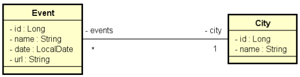

# Desafio 1 DevSuperior - TDD
Primeiro desafio do curso Java Spring Expert do Professor Nélio Alves - Dev Superior.

## Descrição do desafio:

Este é um sistema de eventos e cidades com uma relação N-1 entre eles:

Implemente as funcionalidades necessárias para que os testes do projeto passem

## Critérios de avaliação:
- [x] DELETE /cities/{id} deve retornar 404 Not Found quando id não existir
- [x] DELETE /cities/{id} deve retornar 204 No Content quando id for independente
- [x] DELETE /cities/{id} deve retornar 400 Bad Request quando id for dependente
- [x] POST /cities deve inserir recurso
- [x] GET /cities deve retornar recursos ordenados por nome
- [x] PUT /events deve atualizar recurso quando id existir
- [x] PUT /events deve retornar 404 Not Found quando id não existir

## Competências avaliadas:
- Desenvolvimento TDD de API Rest com Java e Spring Boot;
- Implementação de cenários de busca, inserção, deleção e atualização;
- Tratamento de exceções em API com respostas HTTP customizadas.